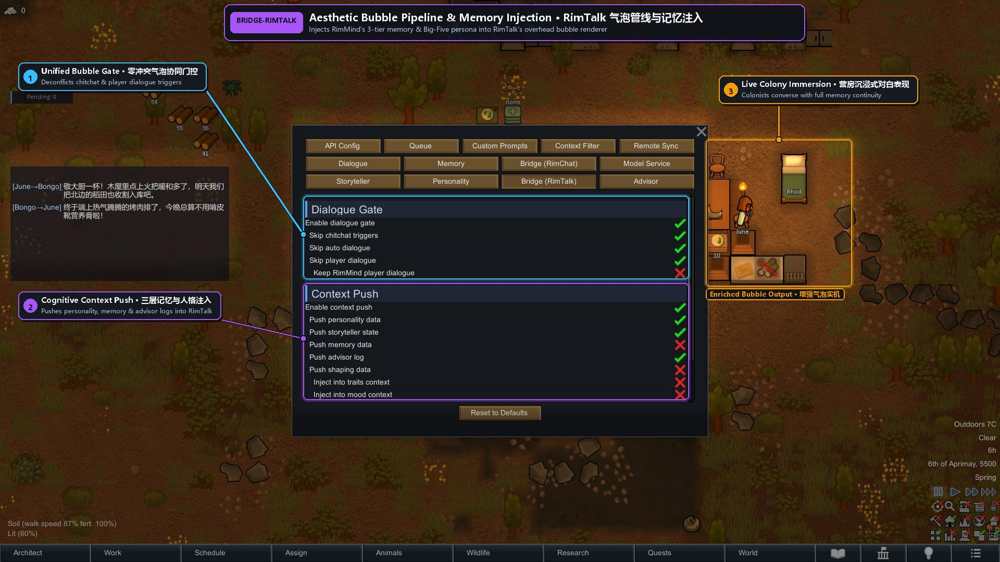
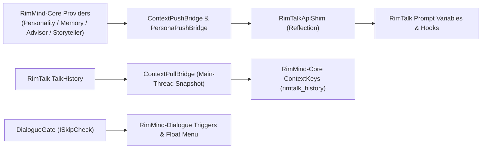

<div align="center">

# RimMind-Bridge-RimTalk 🔗
### Dialogue Gating & Bidirectional Context Bridge for RimWorld 1.6 & 1.7

**English** | [简体中文](README_zh.md)

<p>
  <a href="https://rimworldgame.com/"></a>
  <a href="https://github.com/RimWorld-RimMind-Mod/RimWorld-RimMind-Mod-Core"></a>
  <a href="#"></a>
  <a href="LICENSE"></a>
</p>

<p><em>Coordinates dialogue gating with RimTalk while bidirectionally syncing RimMind personality, memory, advisor, and storyteller context.</em></p>

</div>

---

## 📖 Overview

**RimMind-Bridge-RimTalk** is a zero-compile-dependency compatibility bridge between **RimMind** and the third-party **RimTalk** dialogue mod. It suppresses overlapping RimMind dialogue triggers when RimTalk is active, pushes RimMind cognitive providers into RimTalk prompt variables and context hooks via reflection (`RimTalkApiShim`), and pulls recent RimTalk dialogue history back into RimMind's context engine.

### Key Capabilities
- **Dialogue Mutual-Exclusion Gating**: Independently suppresses RimMind's chitchat, auto dialogue, player input, and "Chat with X" float-menu triggers when RimTalk is active (with an override to keep both player chat entries).
- **Context Push (RimMind → RimTalk)**: Exposes optional RimMind providers (personality, work/social tendencies, AI narrative, memory, shaping history, advisor history, and storyteller state) as RimTalk template variables, a `RimMind Context` prompt entry, and optional Traits/Mood context hooks.
- **Context Pull (RimTalk → RimMind)**: Reads recent `RimTalk.Data.TalkHistory` messages via main-thread snapshots and cached reflection, registering them as the `rimtalk_history` context provider in `RimMind-Core`.

---

## 🎮 In-Game Showcase


*Bidirectional integration in action: RimTalk conversations enriched with RimMind personality, memory, advisor, and storyteller context while RimMind stays aware of RimTalk chat history.*

---

## 🏛️ Bidirectional Bridge Architecture



---

## 🛠️ Installation & Load Order

```text
1. Harmony
2. Core (Vanilla RimWorld)
3. RimTalk (Required third-party mod)
4. RimMind-Core
5. [Optional RimMind submodules: Memory / Personality / Dialogue / Actions / Advisor / Storyteller]
6. RimMind-Bridge-RimTalk
```

---

## 🧪 Developer Guide & Testing

Run unit tests and dual-version builds from the workspace root:

```powershell
dotnet test RimMind-Bridge-RimTalk/Tests/RimMindBridgeRimTalk.Tests.csproj -c Release
dotnet build RimMind-Bridge-RimTalk/Source/RimMindBridgeRimTalk.csproj -c Release -p:GameVersion=1.6
dotnet build RimMind-Bridge-RimTalk/Source/RimMindBridgeRimTalk.csproj -c Release -p:GameVersion=1.7
```

---

## 📜 License

Licensed under the [MIT License](LICENSE).
