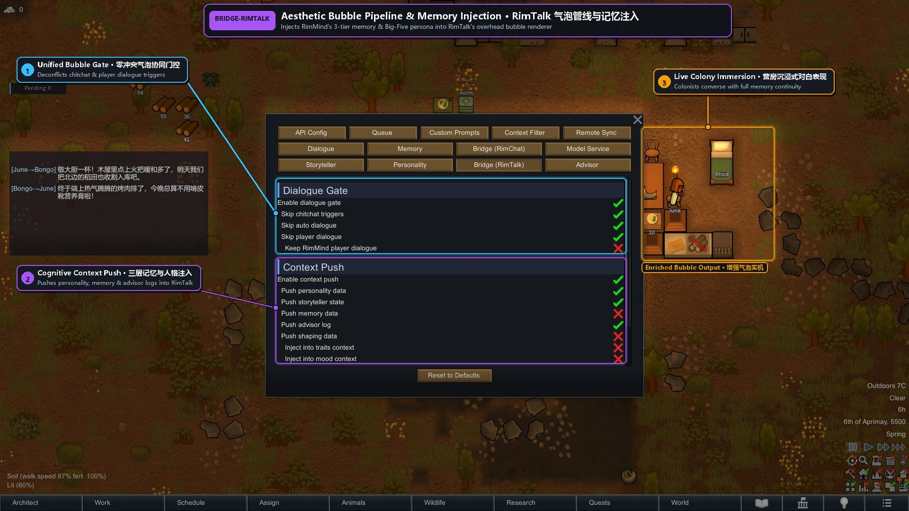
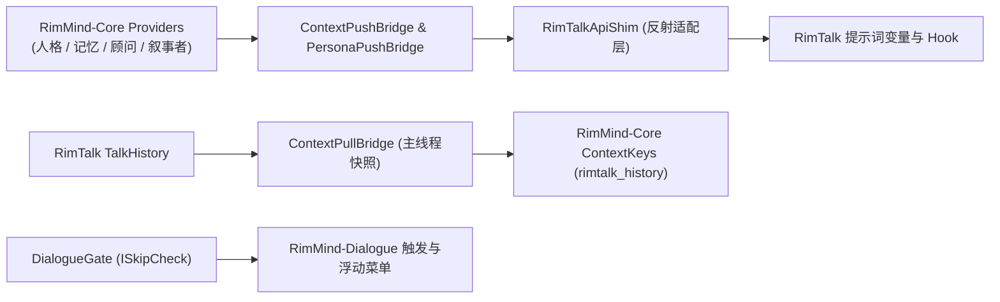

<div align="center">

# RimMind-Bridge-RimTalk 🔗
### 专为 RimWorld 1.6 & 1.7 打造的对话门控与双向上下文桥接模块

[English](README.md) | **简体中文**

<p>
  <a href="https://rimworldgame.com/"></a>
  <a href="https://github.com/RimWorld-RimMind-Mod/RimWorld-RimMind-Mod-Core"></a>
  <a href="#"></a>
  <a href="LICENSE"></a>
</p>

<p><em>在 RimMind 与 RimTalk 之间提供对话互斥门控，并双向同步人格、记忆、顾问与叙事者上下文。</em></p>

</div>

---

## 📖 模块概览

**RimMind-Bridge-RimTalk** 是 **RimMind** 与第三方对话模组 **RimTalk** 之间的零编译依赖兼容桥。它在 RimTalk 激活时按配置抑制重复的 RimMind 对话触发，通过反射封装（`RimTalkApiShim`）将 RimMind 的认知上下文推送为 RimTalk 模板变量与 Hook，并把 RimTalk 的对话历史回流至 RimMind 上下文引擎。

### 核心特性
- **对话互斥门控**：在 RimTalk 激活时分别控制闲聊、自动对话、玩家对话与“与 X 对话”浮动菜单的跳过策略（支持强制保留双入口共存）。
- **上下文推送（RimMind → RimTalk）**：读取已安装的可选 RimMind 子模组 Provider（人格画像、工作/社交倾向、AI 叙事、记忆、塑造历史、顾问记录、叙事者状态），注册为 RimTalk 模板变量、`RimMind Context` 提示词条目及可选的 Traits/Mood Hook。
- **上下文拉取（RimTalk → RimMind）**：通过主线程快照与缓存反射安全读取 `RimTalk.Data.TalkHistory` 近期记录，注册为 `RimMind-Core` 的 `rimtalk_history` 上下文提供器。

---

## 🎮 实机特性展示


*双向协同实机：RimTalk 提示词注入 RimMind 的人格、记忆、顾问与叙事者上下文，同时 RimMind 感知 RimTalk 的近期对话历史。*

---

## 🏛️ 双向桥接架构



---

## 🛠️ 安装与加载顺序

```text
1. Harmony
2. Core (RimWorld 原版)
3. RimTalk (前置第三方模组)
4. RimMind-Core
5. [可选 RimMind 子模组：Memory / Personality / Dialogue / Actions / Advisor / Storyteller]
6. RimMind-Bridge-RimTalk
```

---

## 🧪 开发者测试指南

从工作区根目录运行单元测试与双版本构建：

```powershell
dotnet test RimMind-Bridge-RimTalk/Tests/RimMindBridgeRimTalk.Tests.csproj -c Release
dotnet build RimMind-Bridge-RimTalk/Source/RimMindBridgeRimTalk.csproj -c Release -p:GameVersion=1.6
dotnet build RimMind-Bridge-RimTalk/Source/RimMindBridgeRimTalk.csproj -c Release -p:GameVersion=1.7
```

---

## 📜 开源协议

本项目采用 [MIT License](LICENSE) 开源许可证。
